  <!-- 1. Header & Galaxy SVG -->
  <picture>
    <source media="(prefers-color-scheme: dark)" srcset="./assets/generated/galaxy-header.svg">
    <source media="(prefers-color-scheme: light)" srcset="./assets/generated/galaxy-header-light.svg">
    
  </picture>

  <!-- 2. Contributions Graph SVG -->
  <picture>
    <source media="(prefers-color-scheme: dark)" srcset="./assets/generated/stats-card.svg">
    <source media="(prefers-color-scheme: light)" srcset="./assets/generated/stats-card-light.svg">
    
  </picture>

  <!-- 3. Tech Stack & Languages SVG -->
  <picture>
    <source media="(prefers-color-scheme: dark)" srcset="./assets/generated/tech-stack.svg">
    <source media="(prefers-color-scheme: light)" srcset="./assets/generated/tech-stack-light.svg">
    
  </picture>

  <!-- 4. Featured Constellation Projects SVG -->
  <picture>
    <source media="(prefers-color-scheme: dark)" srcset="./assets/generated/projects-constellation.svg">
    <source media="(prefers-color-scheme: light)" srcset="./assets/generated/projects-constellation-light.svg">
    
  </picture>

