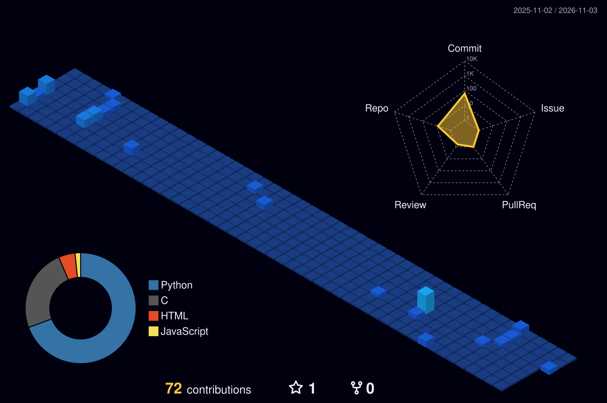

# Arintakdas

### Software development • Problem solving • Continuous learning

I use this space to build projects, explore technology, and share what I learn along the way.

[GitHub profile](https://github.com/Arintakdas)

---

## About

I’m interested in creating useful software and developing my skills through hands-on projects. This profile is a home for my work, experiments, and progress as I learn.

## What you’ll find here

- Personal and learning projects
- Experiments with tools and technologies
- Work in progress and lessons learned

## GitHub activity

  

---

*Always learning. Always building.*

